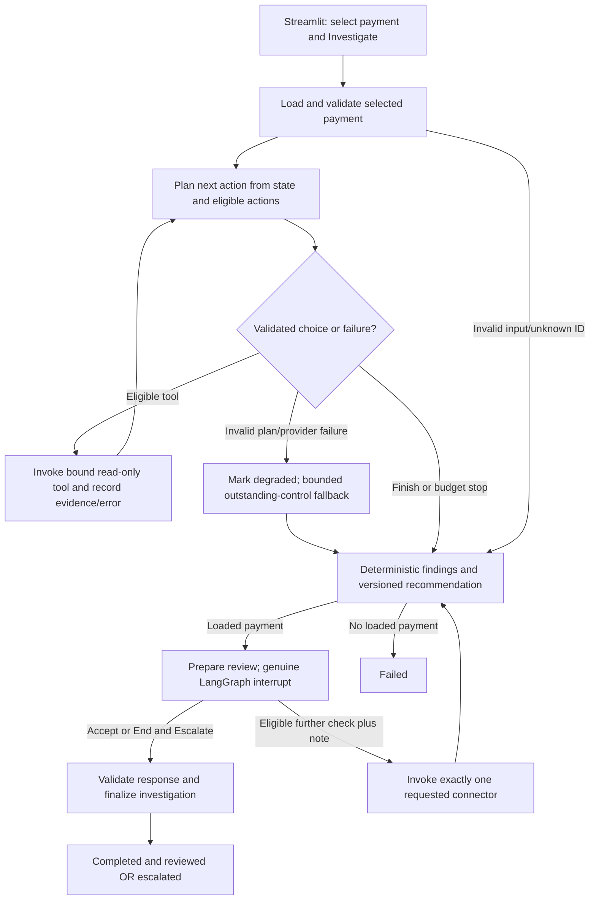

# Payment Investigation Agent

**Mastering Agentic AI - Gen Academy Week 3 submission report**

**Prepared:** November 9, 2026; certification deadline November 11, 2026.

**Project:** PaymentOps AI Platform

**Branch:** `feat/week3-payment-investigation-agent`

**Implementation checkpoint:** `ac85a7e152c0e698d8e2428fb2cf0c3623181bb2`

**Status:** Implementation and owner-reported live rehearsals complete; final recording,
external delivery links, GitHub finalization and actual course submission remain unconfirmed.

## 1. Executive summary

The Payment Investigation Agent helps an operations analyst investigate an existing
synthetic commercial wire. A Nebius LLM selects read-only evidence tools inside a
bounded LangGraph workflow. Application code validates each proposed action,
invokes the existing mock connectors, retains evidence, evaluates deterministic
payment controls and pauses for human review of the investigation recommendation.

This extends the Week 1 wire validation simulator and Week 2 RAG Knowledge Assistant
in one Streamlit application. All banking integrations are simulated. The agent
cannot execute or modify payments. Offline regression tests and three owner-run
live scenarios provide distinct forms of evidence; neither establishes production
readiness or a statistically measured agent success rate.

## 2. Business problem and use case

An analyst investigating a payment must gather account, balance, limit, fraud and
sanctions observations, distinguish missing evidence from a failing control, and
record a reviewable conclusion. Manual cross-control lookup can lose context or
hide an unavailable dependency behind an otherwise reassuring result.

The analyst selects one existing synthetic payment and explicitly starts an
investigation. The application shows the actual action sequence, connector results,
failures, evidence references, simulator finding and review status. An analyst can
accept the recommendation, request one eligible further connector check with a
note, or end and escalate. Acceptance concerns investigation metadata only.

## 3. Agent framework and one-line definition

**My agent helps payment operations analysts investigate an existing synthetic
commercial wire by selecting read-only evidence tools, retaining investigation
state, producing deterministic evidence-backed findings and pausing for human
review, with bounded failure recovery and no payment mutations.**

This is one agent implemented with LangGraph `StateGraph`, LangChain Core
`StructuredTool` wrappers and a Nebius JSON-generation adapter. It performs
multi-step execution, state-dependent tool selection, actual Python tool invocation,
checkpointed review/resume and explicit completion, escalation or failure outcomes.

## 4. Why an agent rather than a fixed workflow or RAG alone?

The Week 1 service already supplies a reliable fixed validation sequence. Week 3
adds model-selected control ordering informed by current observations, failures,
remaining controls and eligible actions. The model can select an eligible transient
recovery; it cannot skip mandatory controls merely because a rejection is known.
Different valid tool orders can reach the same deterministic finding.

RAG answers operational knowledge questions; it does not by itself gather a
selected payment's connector evidence or maintain a reviewable investigation.
The Week 2 assistant remains available separately. Procedure retrieval within the
agent was optional in the PRD and is **not implemented**. Fixed-order fallback is
implemented as safe degradation, not represented as autonomous planning success.

## 5. Synthetic dataset and payment scenarios

The agent reuses the existing tuple of 20 immutable synthetic payment instructions
and existing mock connector fixtures. Scenarios include successful checks, adverse
balance/limit/screening findings, invalid input, boundaries and connector outages.
Exact payment-ID lookup binds one selected instruction to one run. The model cannot
replace the payment or provide arbitrary account identifiers.

The three demonstration IDs are `SYNTHETIC-WIRE-001`,
`SYNTHETIC-WIRE-LOW-BALANCE` and `SYNTHETIC-WIRE-UNAVAILABLE`.
Synthetic data allows reproducible failure demonstrations without customer records,
real account access, sanctions screening services or banking credentials. These
fixtures do not establish compliance with real banking policy.

## 6. Technology stack

| Component | Actual use |
| --- | --- |
| Python 3.13 and uv | Project environment, locked dependencies and pytest execution |
| LangGraph 1.2.20 | Serial state graph, conditional routing, `InMemorySaver`, `interrupt` and `Command(resume=...)` |
| LangChain Core | Zero-argument `StructuredTool` connector wrappers |
| Nebius / httpx | Existing model-verifying JSON chat adapter; separate Week 3 instance |
| Streamlit | Third Workspace view, session-owned controller, evidence and review UI |
| Existing PaymentOps components | Immutable samples, connector contracts/mocks and deterministic decision engine |
| pytest / Streamlit AppTest | Offline injected-provider, real graph/mock and UI regression coverage |

Model selection uses `INVESTIGATION_GENERATION_MODEL`, falling back to
`NEBIUS_GENERATION_MODEL`. No model ID is hardcoded as an automatic runtime default.
The saved Week 2 model is `Qwen/Qwen3-30B-A3B-Instruct-2507`; this report does not
independently attest the model setting used for each owner-run live scenario.

## 7. Architecture and implemented workflow



The actual graph nodes are `load_payment`, `plan_next`, `execute_tool`,
`evaluate_and_summarize`, `prepare_review`, `human_review`,
`execute_review_check` and `finalize_review`. Tool dispatch also records results;
fallback is part of planning rather than a separate graph node. Unknown selections
fail safely; invalid instruction fields skip planner/connector collection.

The original [MVP PRD](WEEK3_MVP_PRD.md) is a historical proposal. In the implemented
graph, the human-requested recheck goes directly to `execute_review_check`, then
summary and a second interrupt; it does not restart the LLM planning loop.

## 8. Agent state design

| State group | Retained information |
| --- | --- |
| Identity | Immutable run ID, controller-owned thread ID, payment ID and canonical payment snapshot |
| Lifecycle | Phase, outcome reason and pending action |
| Work and evidence | Attempted/completed/failed/remaining/unresolved controls; current evidence plus append-only tool attempts |
| Planning | Validated action explanations, model/fallback provenance, planner count and planning status |
| Budgets | Tool count, active elapsed time, shared extra-attempt use and review count |
| Findings | Existing engine findings, gaps, deterministic summary and recommendation revision/evidence IDs |
| Review | Pending review ID, permitted actions, requested control, note and review event history |

Amounts are serialized as strings and dates as ISO strings in JSON-safe state.
Clients, tools, controller and checkpointer remain outside serialized state.
Copy-on-update bookkeeping derives work sets from recorded attempts. Failed rechecks
remove stale current evidence while preserving historical attempts.

## 9. Tool interfaces and selection

| Operation | Underlying call |
| --- | --- |
| Initial `lookup_payment(payment_id)` | Exact lookup in existing synthetic samples; application-controlled and counted |
| `get_core_evidence()` | `CoreBankingConnector.get_account(sender_account_id)` |
| `get_limit_evidence()` | `LimitsConnector.get_limit(sender_account_id)` |
| `get_fraud_evidence()` | `FraudConnector.screen(payment_id)` |
| `get_sanctions_evidence()` | `SanctionsConnector.screen(payment)` |

Only the four connector actions and `finish` are planner choices. Connector tools
have strict empty argument schemas and inputs bound to the selected payment.
The application invokes `StructuredTool` objects; these execute actual mock
connector methods, not model-written tool-result text. Lookup is not a fifth
model-selected connector. Four connectors plus lookup equal five tool attempts;
five planning decisions normally include four tool choices and `finish`.

## 10. Planner and deterministic responsibilities

The planner receives minimal payment reference/amount/date, normalized observations,
findings, failures, remaining budgets and eligible actions. Account/routing numbers
and beneficiary/customer names are excluded from planner context.

The actual [planner instructions](../src/payment_ops/investigation/planner.py) include:

```text
Collect every mandatory control before finish, even if an adverse finding exists.
A failed tool is not PASS.
```

The response must be JSON with exactly `action` and `reason`. The reason is a short
user-visible explanation, not private reasoning. Strict schema, allowlist,
eligibility and reason checks run before dispatch. This is JSON-based validated
action selection, not native provider function calling; the reused adapter rejects
native `tool_calls`.

Code alone binds inputs, enforces limits, records results, evaluates the existing
payment rules and constructs summaries. Week 3 uses temperature zero, a 15-second
request timeout and 400 output tokens. These settings do not guarantee latency or
valid responses. Simulator labels such as REJECTED never execute a payment rejection.

## 11. Human-in-the-loop architecture

The graph compiles with a session-local in-memory checkpointer. `human_review`
calls genuine LangGraph `interrupt()` with a versioned JSON payload. The controller
validates run/payment/review identity, recommendation revision, action, note and
budgets before resuming the same thread with `Command(resume=payload)`; the graph
validates again. A lock serializes controller actions, and stale/duplicate review
responses cannot replay connector calls.

Acceptance completes an investigation only when planning succeeded, required
evidence is usable and input is valid. Acceptance of a degraded/incomplete
investigation is acknowledgment of escalation. End and Escalate terminates without
more collection. Further investigation requires one eligible connector and a short
note; exactly one check updates the recommendation and pauses again.

Streamlit retains one current controller per browser session. Passive reruns and
navigation do not execute tools. Explicit new-run arming and review widget identities
protect against stale UI actions. Reviewer labels are not authenticated identities;
lost sessions or process restarts require a new run.

## 12. Failure handling and safety controls

- All mandatory controls must be attempted before model `finish`; missing usable
  evidence remains explicit and prevents a complete reviewed investigation.
- Malformed, unauthorized, duplicate/ineligible or premature actions and provider
  failures produce sanitized categories, visibly degraded planning and bounded
  deterministic collection of outstanding controls. No further model calls follow degradation.
- Connector failures remain unavailable evidence; other independent controls continue.
  Only narrowly classified transient failures are eligible for model-selected recovery.
- Limits are 7 total dispatched tool attempts, 8 planner attempts, 180 seconds of
  active execution and 2 review rounds. Failed attempts count; human waiting time
  is excluded. The time budget is soft, not hard cancellation of in-flight requests.
- One shared extra connector attempt supports either transient recovery or a human
  recheck, not both. With no guidance tool, four initial connectors plus lookup and
  one extra connector normally total at most six attempts. The configured cap remains seven.
- Graph recursion limit 40 per invocation and sanitized terminal orchestration
  failure handling provide additional bounds. Raw provider responses/secrets are not retained in state.

## 13. Development iterations and genuine Codex prompts

Development proceeded through dependency/smoke verification, state/tools, bounded
planner/graph, human review/resume and Streamlit integration. Local Git checkpoints
are `f4b159f` (state/tools), `9b0598e` (planner/graph), `91fd678` (review/resume)
and `ac85a7e` (Streamlit). These are development checkpoints, not proof of remote upload.

Representative **verbatim excerpts from owner prompts in the development session**:

> Do not implement the Payment Investigation Agent yet.

Task 2 isolated dependency compatibility and interrupt/resume smoke verification
before production agent work.

> Human approval must only apply to the investigation recommendation.

Task 1 established the boundary that shaped graph, tool and review contracts.

> Do not assume the cause.

Task 7B required evidence-led investigation of live degradation. That inspection
initially lacked the live error row; the owner's later Task 8A acceptance record
confirms `planner_timeout`. These excerpts are supplied conversation evidence,
not claimed to be repository-stored prompt transcripts. Codex assisted inspection,
implementation and offline testing; the owner exercised authenticated live scenarios
and remains responsible for review, recording and submission.

## 14. Automated test methodology and current result

On November 9, 2026, `uv run --locked pytest -q` verified **824 passed** across the
repository. This is an offline regression result, including existing Week 1/Week 2
tests, LangGraph smoke coverage, investigation backend tests and 16 investigation
Streamlit tests. It is not 824 independent live-model acceptance tests.

Investigation tests inject deterministic scripted providers into real graph/controller
execution with actual mock connectors. Coverage includes alternate valid tool orders,
adverse findings, immutable payment binding, malformed/unsafe responses, duplicate
actions, time/count/recursion limits, persistent failure and bounded recovery,
genuine interrupts, second review, stale/duplicate/concurrent responses, lost sessions
and navigation isolation. UI tests block external HTTP. Existing Week 2 golden
datasets, corpus and saved evaluations are unchanged.

## 15. Owner-reported live acceptance scenarios

These observations are supplied by the owner in Task 8A, not rerun by Codex for this
report. No saved live trace archive was supplied for independent replay verification.

| Scenario | Observed evidence | Confirmed investigation outcome |
| --- | --- | --- |
| A: `SYNTHETIC-WIRE-001` | Five model planning decisions; lookup plus four successful connectors; all mandatory controls passed; READY FOR PROCESSING; human accepted; attempts stayed five | Completed and reviewed |
| B: `SYNTHETIC-WIRE-LOW-BALANCE` | Core action succeeded; second planner attempt recorded `planner_timeout`; fallback collected remaining evidence; insufficient balance / REJECTED; human Core recheck retained state; six attempts, revision two, second review and extra-check budget exhausted | Autonomous planning degraded; second human review reached. Final terminal outcome not confirmed |
| C: `SYNTHETIC-WIRE-UNAVAILABLE` | Five model planning decisions; Fraud `connector_unavailable`; other controls completed; missing fraud evidence; MANUAL REVIEW; human selected End and Escalate; five attempts, one review round | Escalated |

Scenario B demonstrates safe fallback and human recheck, not fully autonomous
planning success. Scenario C demonstrates honest incomplete evidence and safe
escalation. These three rehearsals do not establish an 80% or 90% success rate.

## 16. Limitations

Live planner variability includes the observed Scenario B timeout. The sanitized
category confirms timeout classification, not a provider/network root-cause analysis.
No formal Week 3 latency benchmark, broad held-out reliability study, persistent
cross-session memory, authenticated reviewer identity or production audit system
is implemented. In-memory review cannot survive restart. Mock connector behavior
does not predict real bank availability. Week 2 human faithfulness review and formal
latency qualification remain outstanding historical items; Week 3 does not resolve them.

## 17. Engineering lessons

Separating tool choice from payment rules keeps decisions reproducible despite model
variability. Recording current evidence separately from append-only attempts avoids
stale PASS results. Genuine interrupts require both durable-in-session state and
strict review identity, not just UI buttons. A correct rejected payment finding can
coexist with degraded investigation planning. Finally, safe fallback must remain
visible: successful evidence gathering does not erase a planner timeout.

## 18. Future improvements (not implemented)

Potential later work includes richer allowlisted provider diagnostics, broader
held-out planner evaluation and latency measurement, durable checkpoint storage,
authenticated review/audit controls, and optional bounded RAG procedure guidance.
Any changes need separate design and authorization. Multi-agent design, MCP, A2A,
external banking APIs, payment execution, AWS deployment and production authentication
are outside this course MVP.

## 19. Repository, reproduction and submission instructions

Repository: [ThiyaguAIEngineer/paymentsops-ai-platform](https://github.com/ThiyaguAIEngineer/paymentsops-ai-platform).
Select branch `feat/week3-payment-investigation-agent` after authorized GitHub
finalization; this report does not assert that the Week 3 branch is already pushed.
See the [Streamlit guide](WEEK3_STREAMLIT.md),
[recording script](WEEK3_GEN_ACADEMY_DEMO_SCRIPT.md),
[project state](../PROJECT_STATE.md), [tests](../tests/investigation/test_graph.py)
and [Week 2 submission](WEEK2_GEN_ACADEMY_SUBMISSION.md).

From the repository root in PowerShell:

```powershell
uv sync --locked
uv run --locked pytest -q
uv run streamlit run src/payment_ops/ui/app.py --browser.gatherUsageStats=false
```

Configure `NEBIUS_API_KEY` securely in the launching process and select a model with
`INVESTIGATION_GENERATION_MODEL` or fallback `NEBIUS_GENERATION_MODEL` before live
planning. Optional `NEBIUS_BASE_URL` defaults to `https://api.tokenfactory.nebius.com/v1`.
No embedding model is needed for this agent view. Restart after environment changes;
do not expose credentials in recordings or documents.

Before November 11: review documentation, authorize commit/push separately, verify
remote branch and accessible links, record a video under five minutes, upload it,
prepare/share any required Google Doc, confirm course portal requirements and cutoff
timezone, submit and retain confirmation. Video/Google Doc URLs and actual course
submission are not yet confirmed. Repository links describe the configured project
destination; external availability must be checked during finalization.
